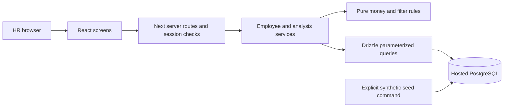

# Engineering decisions

## Architecture

A modular monolith keeps one deployable application while isolating salary rules from React, HTTP and SQL.

Modules: domain/money and filters (pure); server/db (schema/connection); server/employees and analysis (queries/use cases); server/auth (evaluator sessions); app routes (transport); components (interaction). Do not create generic repository/service base classes.

## Approved working decisions

Current annual base pay; explicit currency and period; no cross-currency normalization. Salary edits only. Employee metadata is read-only. History and scheduled changes are excluded. These are user decisions pending external clarification. A reply must be traced through REQUIREMENTS, schema/migration, parsing/calculation rules, server queries, UI labels, tests and docs before changes.

## Data and arithmetic

Use BIGINT minor units and string API serialization. Currency definitions include precision. Proposed illustrative currencies: USD, EUR, GBP, INR, JPY and KWD (0/2/3 decimal coverage); country and pay currency are independent. Enforce positive bounded amounts and foreign keys. Median of even populations retains half-minor-unit precision until display. Proposed rounding: half up for displayed money and percentages, two percentage decimals. No floating point money conversions.

Employee includes unique employee number, name, country/department/role keys, salary amount/currency/annual period, version and updatedAt. A version-conditional update prevents silent lost writes. Parameterize values, allowlist sorting, use stable id tie-breakers and capped page sizes. Shared filter semantics cover pages, summaries and drill-downs. Exact aggregates operate on all filtered rows.

One evaluator identity protects UI and every data API; session signing and credential verification stay server-side. No public bypass. Anonymous readiness returns no employee data. Mutations validate origin as well as session. Preview environments must not use the demo connection for writes.

## Database and hosting

Hosted PostgreSQL for development; isolated test and demo connections/branches. Vercel Node 24 + Neon pooled runtime connection; migrations use a designated direct connection. No filesystem database. Explicit migration/seed commands, never at build/request time. Neon Free documentation checked 2026-11-11 lists 10 branches/project, 100 CU-hours/project, 1 GB/project and scale-to-zero after 5 minutes. Cold starts are measured separately. Vercel Hobby is for personal/non-commercial projects; this synthetic assessment is a personal demonstration. No purchases or paid upgrades.

Sources: https://neon.com/docs/introduction/plans ; https://vercel.com/docs/plans/hobby ; https://vercel.com/docs/functions/runtimes/node-js/node-js-versions . Account quotas may differ and will be checked before provisioning.

## Foundation reuse map

| Reference                                  | Reuse                                                                                        | Adapt or exclude                                                                   |
| ------------------------------------------ | -------------------------------------------------------------------------------------------- | ---------------------------------------------------------------------------------- |
| Job Desk DESIGN.md / globals.css           | Neutral ramp, compact type, semantic roles, tactile controls, hairline depth, reduced motion | New green/lime accents; remove job statuses, language and hard-coded status colors |
| components.json                            | Base-nova aliases and CSS-variable configuration                                             | Keep only dependencies actually used                                               |
| ui/button, input, table, skeleton, spinner | Small reviewed primitives                                                                    | Correct contrast, visible focus and 44 px touch targets                            |
| ui/sheet and dialog                        | Base UI/Animate UI accessible overlay patterns                                               | Scroll containment, labelled dialogs, safe close behavior and reduced motion       |
| providers / typography                     | next-themes, Geist, Animate UI user motion preference                                        | No PWA, service workers, dev instrumentation or private providers                  |
| app-shell / sidebar                        | Inset canvas, desktop navigation, responsive mobile navigation                               | Recompose for Employees and Salary overview only; no full-dataset search index     |
| design-check                               | Mechanical document-to-CSS verification                                                      | Check both themes and contrast; Markdown documents CSS, does not generate it       |

Observed defects before reuse: original primary orange/white contrast is below 4.5:1; focus rings rely on a low-opacity accent; button/input defaults can be shorter than 44 px; app shell depends on private pipeline/domain state. These are not imported as accepted behavior.

## Brand observation

Official https://incubyte.co/ inspected 2026-11-11. Inline public styling repeatedly uses deep green #014d43 and lime #d3fe73. These are observed website accents, not a published brand standard. Do not copy trademarks/logos into an apparent internal HR application. ACME stays fictional; footer identifies the assessment concept.

## Interview walkthroughs

These are planned: follow one amount from decimal input to minor units; one list query from URL filters to SQL; one authenticated API request to its service; one edit from UI through a version check and refresh. Update with exact code paths after implementation.

## Implemented verification and performance

24 deterministic unit cases pass. Five PostgreSQL integration cases passed on isolated hosted PostgreSQL 17.11. Six browser checks passed against a fresh production build, including real save/reload/analysis. The SQL summary ranks the full filtered population, sums the one or two middle values as numeric text, and retains a denominator of one or two. It never uses floating-point percentile_cont.

Measured 2026-11-11 on 10,000 synthetic employees, Node 24.19/Windows, client in India, Neon aws-us-east-2, TLS verified, pooled max 3, five sequential samples after ANALYZE. Median service transactions: name page 1,330.55 ms; USD salary page 1,204.66 ms; country/department page 1,202.63 ms; Unicode search 1,317.06 ms; full USD analysis 1,529.07 ms. These include WAN and transaction round trips and are not deployment latency or cold-start results. EXPLAIN execution observations: indexed currency/salary page 0.034 ms, name search 0.513 ms, overall analysis 2.086 ms. See [raw observations and plans](performance.json); run npm run perf:measure to reproduce. Five samples do not establish an SLA.

Current schema indexes support name/id pagination, currency/salary/id ordering, country/department and department/role filters. Plans and data size support retaining this small set; no speculative search service or extra infrastructure.

## Four interview walkthroughs

- **One amount:** src/domain/money.ts parses INR 1200000.01 as 120000001n, rejecting excess precision rather than rounding user input. PostgreSQL stores BIGINT; JSON uses a string. Two middle values 101/102 USD minor units yield 203/2 minor units; display is USD 1.02 while the explanation retains USD 1.015.
- **One query:** src/domain/filters.ts validates URL values. server/employees/queries.ts escapes literal search wildcards, builds one parameterized predicate, allowlists order expressions and adds employee id for stable ties. The list/count transaction and analysis CTE use the same predicate. The browser receives at most 100 employees.
- **One API request:** PATCH app/api/employees/[id]/route.ts passes through server/http.ts: evaluator session, trusted origin, id/JSON validation, then domain/saveSalary. The service checks units and parses the amount. salary-repository.ts updates WHERE id AND version and increments the version in the same statement. No returned row means a conflict, never silent success.
- **One save:** components/salary-editor.tsx keeps the draft separate from the current snapshot. It previews the exact difference, submits its version, and shows success only after a confirmed response. Errors retain the draft. A conflict shows the latest value and requires review before rebasing the retained proposal. Closing a dirty sheet requires a discard decision.

## Final refinements

The unused department/role junction was removed by a new migration: employee metadata is read-only, so a configurable compatibility relation served no workflow. The six remaining tables are employees, countries, currencies, departments, roles and the environment marker. Database connection settings bound connection/statement/query/idle-transaction waits. Unexpected API failures expose a reference while logging only method/path, error kind and sanitized database code; never SQL parameters or credentials.

The design checker resolves the actual semantic token mappings in each theme, including text/action/status contrast and focus contrast. It also rejects undocumented palette literals in components. It does not generate CSS.
