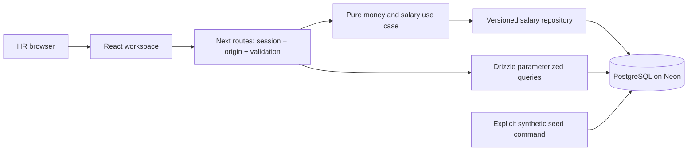

# Engineering decisions and walkthroughs

## Product boundary and change handling

Current annual base salary, positive values, explicit currency and annual period, single-currency analysis, current-value edits only. These are candidate-approved working definitions pending Incubyte clarification. No FX, payroll, creation/deletion, history, scheduled changes or product LLM.

When clarification arrives, trace its impact before changing code:

| Clarification                  | Affected implementation                                                                       |
| ------------------------------ | --------------------------------------------------------------------------------------------- |
| Base versus total compensation | REQUIREMENTS, schema/components, validation, seed, aggregation and tests                      |
| Monthly or mixed pay periods   | Period constraints, normalization policy, calculation/display rules and fixtures              |
| FX comparison                  | Approved rates/as-of policy, normalization model, aggregates and labels; currently prohibited |
| History/effective dates        | Data model/migrations, update use case, UI and concurrency/integration tests                  |
| Employee operations/access     | API authorization, schema rules, interaction and acceptance checks                            |

## Modular monolith

src/domain contains money, filters, analysis definitions and the salary-update use case. src/server/db owns schema/connection; employees and analysis modules own SQL; HTTP routes adapt transport and enforce access. Components own drafts and interaction, never direct DB access. The salary use case depends on two small repository operations; no generic service/repository framework or separate backend.

## Exact money and schema

Six tables: employees, countries, currencies, departments, roles, and a singleton environment marker. Foreign keys, unique employee numbers, positive salary/version checks and an annual-period constraint protect persisted data. An unused role/department mapping was removed with a real migration because metadata editing is excluded.

Salary is BIGINT minor units, capped at 9,000,000,000,000,000,000 (below PostgreSQL's signed ceiling). USD/EUR/GBP/INR use two decimals, JPY zero, KWD three. Country and pay currency are independent. Decimal strings are parsed directly into BigInt; excess precision, ambiguous notation, non-positive and out-of-range amounts are rejected. Money crosses JSON boundaries as strings. No unsafe Number conversion.

SQL totals use numeric arithmetic and text serialization. Median ranks the entire population and sums its one or two middle values, retaining denominator one or two. An even median can include half a minor unit; the explanation shows it exactly. Display rounding is half up; signed changes round half away from zero, and percentages have two decimals. There is no floating-point percentile calculation or cross-currency monetary total.

## Lists, populations and safe writes

One employeeWhere predicate applies literal wildcard escaping and parameterized country/department/role/currency filters to lists, counts and analysis. Sorting is allowlisted with an id tie-breaker; salary sorting requires a currency. Pages are 25/50/100 records. Count/list and overall/group analysis run in repeatable-read, read-only transactions so one response describes a consistent population. Drill-down retains the same filters. Unknown or unavailable lookup labels retain active codes rather than claiming All.

Salary edits validate immutable currency/period and parse the amount on the server. UPDATE checks both id and expected version, increments the version and writes server metadata atomically. No returned row means conflict. The UI retains the proposal after validation, network or persistence failure; conflict review rebases it explicitly against the latest snapshot. Success is shown only after a confirmed response. A network failure after commit is treated as uncertain and resolved by rereading/version checks.

## Access and environments

A shared evaluator identity uses an eight-hour encrypted iron-session cookie: HttpOnly, Secure in production, SameSite Strict. Server layout and every data API check the session; mutations also validate origins. Trust comes from explicit APP_ORIGIN and Vercel-issued deployment variables, never request Host or forwarded headers. Health exposes no employee data. Unexpected API failures return a reference and log only method/path, error kind and a sanitized database code.

Development, test, demo and preview use separate PostgreSQL databases with purpose markers. Runtime/migration checks reject mismatches; Vercel preview requires purpose preview and production requires demo. Tests reject development/demo/preview connection identities, including pooled/direct aliases, and browser writes first assert the server's test-purpose header. CI uses disposable PostgreSQL 17; local development needs no Docker.

Neon's account-free project was used initially. The candidate has claimed it into a Free account; account access and all four 10,000-row databases were verified. Claiming rotated the database password, so only connection URLs were refreshed and deployment credentials updated. Data, evaluator secrets and business scope were preserved. No paid resources.

Vercel Hobby, Node 24 and region iad1; Neon aws-us-east-2. Runtime uses pooled node-postgres with attachDatabasePool, max three connections; migrations use direct URLs. Connection/query waits are bounded; statement timeout is eight seconds. Seed/reset are explicit operator commands, never build/request hooks. Production builds are verified with runtime credentials absent. The reviewed Windows/Turbopack development reload loop is avoided using supported Webpack development; default production builds pass independently.

## UI foundation and brand

| Job Desk reference      | Selective adaptation                                                                         |
| ----------------------- | -------------------------------------------------------------------------------------------- |
| DESIGN / globals.css    | Neutral surfaces, compact type, semantic roles, hairlines and tactile controls               |
| Base UI/shadcn wrappers | Small button/input/sheet patterns; corrected focus contrast, touch size and overlay behavior |
| Providers/fonts         | next-themes, packaged Geist and Animate UI reduced-motion preference                         |
| Shell/sidebar           | Recombined Employees/Salary overview navigation; responsive cards/table                      |
| Design checker          | Document-to-CSS palette checks, resolved theme contrast and semantic color checks            |

No job domain, personal data, integrations, Blob sync, PWA/service worker, all-record client index, dev instrumentation or Git history was copied. Applicable notices are retained. Sheet review caught generic-dialog motion and missing close-event cancellation; both were corrected and browser tested.

Official incubyte.co styling inspected 2026-11-11 repeatedly used green #014d43 and lime #d3fe73. These are observed website accents, not a published brand standard. ACME is fictional and the footer identifies an independent assessment concept; no official Incubyte product/logo claim. DESIGN.md documents runtime CSS; it does not generate it.

## Evidence and practical performance

27 deterministic unit cases, eight hosted PostgreSQL integration cases, and six production browser checks passed. Coverage includes precision/bounds, exact large aggregates, odd/even/empty medians, literal search, shared intersections, constraints, seed preservation and a simultaneous-write race with one winner. Controlled UI failures are distinguished from live persistence evidence. Deployed checks confirm authentication, bounded 10,000-record browsing, invalid/stale rejection, save/reload, analysis and persistence across redeployment; original synthetic amounts were restored. Production is published at https://incubyte-salary-desk.vercel.app and source at https://github.com/Ayuxh-Pratap/incubyte-salary-desk, with candidate approval. Hosted CI independently passed all 27/8/6 checks on disposable PostgreSQL. See deployment-checks.json.

Measured 2026-11-11: 10,000 employees; Node 24.19/Windows; client in India; Neon US East; TLS verified, pooled max 3; five sequential samples after ANALYZE. Median transactions: name page 1,330.55 ms; USD salary page 1,204.66 ms; country/department page 1,202.63 ms; Unicode search 1,317.06 ms; full USD analysis 1,529.07 ms. These include WAN and transaction round trips, not deployment latency or cold starts. EXPLAIN execution: indexed currency/salary page 0.034 ms, name search 0.513 ms, overall analysis 2.086 ms. Raw observations/plans are in performance.json. Five samples do not establish an SLA.

Indexes cover name/id, currency/salary/id, country/department and department/role. Retain this small set based on the measured workload; no external search service, replicas or speculative infrastructure.

## Four interview walkthroughs

1. **An amount:** domain/money.ts turns INR 1200000.01 into 120000001n. Input is never rounded. JSON carries a string. Middle values 101/102 USD minor units yield 203/2; display USD 1.02, explanation USD 1.015.
2. **A query:** domain/filters.ts validates URL input; server/employees/queries.ts creates the shared predicate, stable order and bounded page. server/analysis/queries.ts applies that predicate to the full population and ranked middle rows, independent of the current page.
3. **An API request:** PATCH app/api/employees/[id]/route.ts passes through server/http.ts for session/origin checks, validates id/JSON, then calls domain/salary-update.ts. server/employees/salary-repository.ts performs the version-conditional update. A race yields HTTP 409.
4. **A save:** components/salary-editor.tsx keeps a separate draft and snapshot, computes the preview, submits its version and handles confirmed success, retained failure and explicit conflict review. Employee detail is an accessible controlled sheet; dirty closure requires a discard decision.

The defensible tradeoff is a small complete current-salary tool with exact arithmetic and transparent populations. History, FX and full IAM require additional business decisions and are deliberately excluded.

Sources: [Incubyte website](https://incubyte.co/), [Neon plans](https://neon.com/docs/introduction/plans), [Vercel Hobby](https://vercel.com/docs/plans/hobby), [Vercel Node runtime](https://vercel.com/docs/functions/runtimes/node-js/node-js-versions). Provider/account observations were checked during setup; current account is Free/Hobby.
