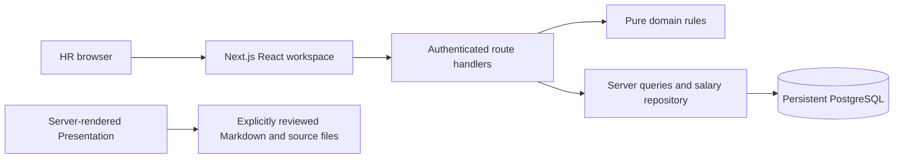
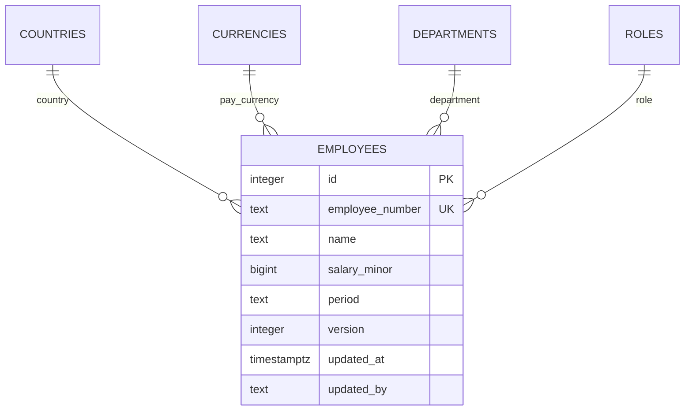

# Architecture and engineering decisions

This describes the implemented system. [Local setup](LOCAL_SETUP.md), [interview walkthrough](INTERVIEW.md), [assessment report](PRESENTATION.md) and [delivery checklist](DELIVERY.md) serve different reading needs. Historical performance reports retain their original sources; current release checks are recorded separately.

## Product boundary

ACME's HR Manager can browse employees, inspect and correct current annual base salary, and analyze a defined population in one currency. These are candidate-approved working definitions **pending external clarification**, not employer approval. No reply text has been supplied for this release. Bonuses, equity, benefits, deductions, payroll, FX, employee creation/deletion, history and future-effective changes are excluded.

## Modular monolith



| Boundary | Responsibility and code |
| --- | --- |
| Domain | Exact money, salary proposals, filters and statistics; `src/domain/` has no React/HTTP dependency |
| HTTP | Session, origin and request validation; `src/server/http.ts`, `src/server/auth.ts`, `src/app/api/` |
| Persistence | Drizzle schema, purpose-checked pool, parameterized queries and version-checked updates; `src/server/db/`, `src/server/employees/`, `src/server/analysis/`, `src/server/dashboard/` |
| Workspace | Draft controls, pending/error states, exact labels and confirmed saves; `src/components/` |
| Browser reads | Session-scoped bounded cache, deduplication and invalidation; `src/lib/read-cache.ts`, `remote-provider.tsx`, `use-remote.ts` |
| Report | Selected file catalog and literal loaders; `src/server/presentation/`. Does not read employee data or load Chart.js |

## Relational model



Lookup foreign keys prevent invalid references. Salary must be positive and bounded; period is explicitly annual; versions are positive. A separate environment-purpose singleton protects development/test/demo/preview operations. See `src/server/db/schema.ts` and committed Drizzle migrations. No schema change or data reset is needed for this release.

## Exact money and analysis

Amounts enter as strings and become **BIGINT minor units**. USD/EUR/GBP/INR have two decimal places, JPY zero, KWD three. Parsing rejects extra precision, invalid syntax, zero/negative and amounts above `9_000_000_000_000_000_000` minor units. JSON carries monetary strings, never unsafe JavaScript numbers.

PostgreSQL NUMERIC supports exact aggregate arithmetic. An even median retains its rational half-unit rather than truncating it; display rounding is deliberate, half away from zero. Totals, min/max, medians and salary-change previews have deterministic rule tests. Counts may become chart numbers; money labels/tooltips retain exact formatted values. No mixed-currency salary total or comparison is offered. Annual-base labels, currency and population remain explicit.

Employee lists and analysis share `employeeWhere` filter semantics, including literal escaping of search wildcards. PostgreSQL applies filtering, allowlisted sorting and stable ID tie-breaking. Pages are bounded to 25/50/100. Salary sorting requires one currency. A window count returns a normal page and total in one statement; an out-of-range offset has a focused count fallback. Analysis uses one statement for overall and grouped results from the same filtered population. Dashboard derives global headcounts and one-currency summary/eight histogram bins server-side, without returning employee rows to charts.

## Read and save flows

```mermaid
sequenceDiagram
  participant HR
  participant UI as Salary editor
  participant API as Protected PATCH
  participant DB as PostgreSQL
  HR->>UI: Inspect current value and propose change
  UI->>UI: Exact preview, keep expected version
  UI->>API: Amount string, currency, annual period, version
  API->>API: Session + trusted-origin + Zod/domain checks
  API->>DB: UPDATE WHERE id AND version; increment version
  alt Version matches
    DB-->>API: Updated employee and metadata
    API-->>UI: Confirmed result
    UI->>UI: Invalidate dependent reads, retain confirmed detail
  else Another edit won
    DB-->>API: No matching update
    API-->>UI: 409 conflict
    UI->>HR: Preserve draft; review newer salary
  end
```

The database conditional update is the concurrency boundary, not a client-only check. Validation, failure, conflict and uncertain network outcomes preserve the draft; success requires confirmation. Server metadata is authoritative. See `salary-update.ts`, `salary-repository.ts`, salary API handler and `salary-editor.tsx`.

## Cache ownership and freshness

Each authenticated login has a random encrypted session scope. The provider owns at most **24 in-memory entries**, with no salary payloads in localStorage and no shared public response cache. Keys include the endpoint's canonical filter/sort/page/size/currency and provider scope. Active list/analysis/dashboard reads are fresh for 30 seconds, detail for 15 seconds, lookups for 300 seconds; retained stale data has a bounded additional window. Inspect `src/lib/read-cache.ts` for the authoritative per-endpoint policy.

Concurrent same-key requests deduplicate. Generation checks and abort handling stop superseded responses from overwriting newer state. Hidden-tab expiry defers network work until visible; focus does not refetch a fresh entry. Unchanged background responses retain the current data reference. Saves invalidate dependent lists, analyses, Dashboard and detail, then seed the confirmed detail; cross-tab invalidation uses BroadcastChannel. Sign-out and unauthorized responses clear protected entries. Explicit Refresh/Retry remains available. This is short-lived reuse, not permanent offline storage or a real-time multi-user subscription.

Same-route query navigation uses browser history and the cache rather than an unnecessary RSC round trip followed by JSON. New routes still pass server access checks. Filters apply as one accepted draft, never on every draft select change. Cached returns avoid a forced skeleton; uncached reads preserve controls and acknowledge pending work immediately.

## Chart lifecycle

Chart.js is scoped to Dashboard. The earlier replay defect came from destroying/recreating chart instances when arrays/callbacks changed identity and when broad root mutations fired. The correction keeps one instance per mounted canvas/type/orientation, keeps event callbacks current through refs, and updates changed data/theme in place. Unchanged revalidation does not restart entry animation. A narrow resolved-theme signal replaces the broad observer; reduced motion is respected. Unmounting legitimately destroys the instance. The shared lifecycle also covers the histogram. Historical before/after idle observations and focused browser regression checks document this distinction.

## Access, environments and deployment

Eight-hour encrypted HttpOnly evaluator sessions protect both server pages and API handlers; production cookies are Secure with SameSite Strict. Mutations validate configured trusted origin, not an untrusted Host header. Request boundaries reject invalid parameters and sanitize server errors. A shared evaluator identity is suitable for this synthetic assessment, not a complete HR identity/audit system.

Development, test, demo and preview have distinct connections and database-purpose markers. Test preparation fails closed if its URL aliases a configured development/demo/preview database. Runtime/migration purpose mismatches are rejected. The pool is reused per process, capped at three connections with bounded idle/connect timeouts; Vercel lifecycle integration releases idle connections. Vercel uses the package's supported Node 24 runtime in `iad1`, near the persistent Neon US East database. Salary data is not stored on an ephemeral deployment filesystem. Production secrets and evaluator codes stay in private configuration. Preview must use its own purpose-marked database.

## Decisions and observed limits

| Choice | Why; alternative deliberately deferred |
| --- | --- |
| Next.js modular monolith | One deployable with explicit backend modules; a separate service adds no assessment value |
| PostgreSQL + Drizzle | Persistent relational constraints and server aggregates; ephemeral SQLite is unsuitable here |
| Minor-unit BIGINT plus rational aggregate values | Avoid binary floating-point money; arbitrary FX/history policy is outside agreed scope |
| Offset pagination | Simple and stable for 10,000 records; cursor pagination needs a demonstrated scale/use-case benefit |
| Small session cache | Fast visited views without Redis, public caching or an additional query framework |
| No product LLM | HR workflows are deterministic; AI assistance is demonstrated honestly through development artifacts |

Historical focused measurements on source `730076b` found 25-row responses around 6.7 KB, cached returns around 56–60 ms without an API call, and uncached list observations around 908–939 ms. These are small local-production samples, not new release timings or an SLA. One list SQL plan executed in 4.334 ms; pooled WAN reads and new-pool setup were materially slower than SQL execution. See [historical final-pass report](FINAL_PASS.md) and its raw, source-labeled artifacts. No load/failover SLA, full assistive-technology audit or production HR security certification is claimed.

If clarification changes the business rules, identify affected requirements, schema/migrations, domain parsing/analysis, API validation, seed fixtures, tests and UI/docs before changing them. Keep canonical policy small rather than adding a speculative policy engine.

## Evidence and authorship

[AI collaboration](AI_COLLABORATION.md) records actual instructions, accepted/revised suggestions and corrections. Git history preserves the real sequence; later documentation is not evidence of a fictional test-first cycle. Job Desk's reviewed visual foundation was adapted independently with third-party notices; its private data/integrations were not copied. [DESIGN.md](../DESIGN.md) documents the runtime tokens and consistency check.
